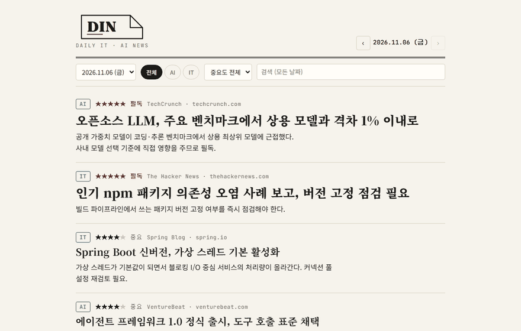
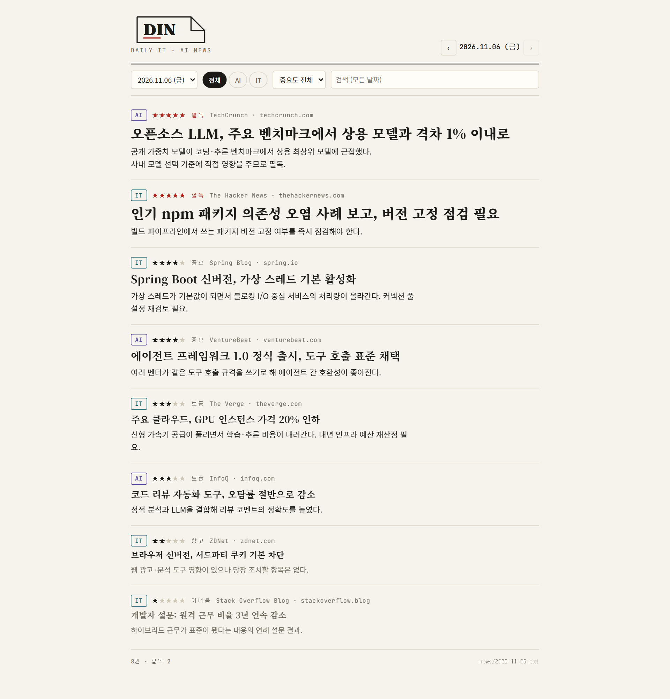
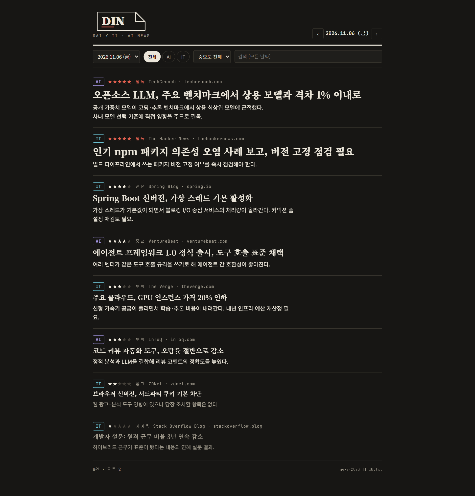
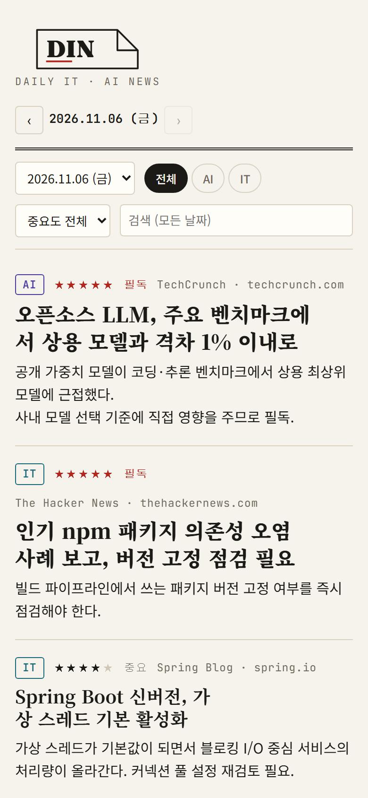
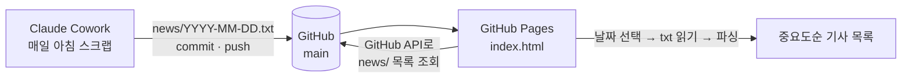

<p align="center">
  <picture>
    <source media="(prefers-color-scheme: dark)" srcset="docs/logo-dark.png">
    
  </picture>
</p>

<h3 align="center">Daily IT · AI News</h3>

<p align="center">
  매일 아침 Claude Cowork가 IT/AI 뉴스를 스크랩해 <code>news/</code>에 푸시하면,<br>
  GitHub Pages가 그 폴더를 읽어 날짜별·중요도순으로 보여주는 페이지입니다.
</p>

<p align="center">
  <a href="https://sjc4197.github.io/daily_IT_news_din/"></a>
  <a href="https://github.com/sjc4197/daily_IT_news_din/commits/main"></a>
  <a href="FORMAT.md"></a>
</p>

<br>

<p align="center">
  
</p>
<p align="center"><sub>분류(AI/IT) 필터 → 중요도 필터 → 날짜 이동 → 전체 날짜 검색. 화면의 기사는 샘플입니다.</sub></p>

<br>

## 화면

<table>
  <tr>
    <td align="center"><b>라이트</b></td>
    <td align="center"><b>다크</b></td>
    <td align="center"><b>모바일</b></td>
  </tr>
  <tr>
    <td></td>
    <td></td>
    <td></td>
  </tr>
</table>

다크 모드는 OS 설정을 따라갑니다.

## 중요도

기사마다 `importance` 1~5를 매기면 페이지가 이렇게 표시합니다.

| 값 | 라벨 | 표시 |
|:--:|:--|:--|
| 5 | **필독** | 붉은 ★★★★★, 가장 큰 제목 |
| 4 | 중요 | ★★★★☆, 큰 제목 |
| 3 | 보통 | ★★★☆☆ |
| 2 | 참고 | ★★☆☆☆, 작은 제목 |
| 1 | 가벼움 | ★☆☆☆☆, 회색으로 가라앉힘 |

같은 날짜 안에서는 항상 중요도 높은 순으로 정렬됩니다. 툴바에서 `★4 이상`, `필독만`으로 걸러 볼 수 있습니다.

## 동작 방식



- 빌드 단계가 없습니다. `index.html` 하나가 GitHub API로 `news/` 폴더 목록을 가져와 txt를 직접 파싱합니다.
- 새 txt를 `main`에 푸시하면 Pages 반영 후 바로 보입니다. 인덱스 파일을 따로 갱신할 필요가 없습니다.
- `#2026-11-06` 처럼 날짜를 해시로 붙이면 그 날짜로 바로 열립니다.

## 파일 양식

`news/YYYY-MM-DD.txt` 하루 한 파일. 기사 사이는 `---` 한 줄. 자세한 규칙은 [FORMAT.md](FORMAT.md).

```
title: 오픈소스 LLM, 주요 벤치마크에서 상용 모델과 격차 1% 이내로
category: AI
importance: 5
source: TechCrunch
url: https://techcrunch.com/...
summary: 공개 가중치 모델이 코딩·추론 벤치마크에서 상용 최상위 모델에 근접했다.
detail: 연구팀이 공개한 신규 모델이 코딩·수학·추론 벤치마크에서 상용 최상위 모델과 1% 이내 격차를 기록했다.
- 가중치와 학습 레시피를 모두 공개해 자체 호스팅과 파인튜닝이 가능하다.
- 동일 성능 기준 추론 비용이 상용 API 대비 약 1/5 수준으로 추정된다.
사내에서 상용 API를 쓰는 서비스는 자체 호스팅 전환을 검토할 시점이다.
---
title: 국내 통신 3사, 데이터센터 전력 공동 조달 계약
category: IT
importance: 3
source: 한국경제
url: https://hankyung.com/...
summary: AI 수요 급증으로 데이터센터 전력 확보가 업계 공통 과제가 됐다.
detail: 통신 3사가 신규 데이터센터용 전력을 공동 조달하는 장기 계약을 체결했다.
- 계약 규모는 5년간 총 1GW 수준, 재생에너지 비중을 단계적으로 확대.
당장 영향은 없지만 중장기 클라우드 요금 인상 요인이다.
```

`summary`는 목록에서 항상 보이는 한 줄이고, `detail`은 "상세 요약 보기"를 눌렀을 때 펼쳐지는 긴 요약입니다.

## Claude Cowork 지시문

```
매일 아침 IT/AI 뉴스를 스크랩해서 이 레포의 news/ 폴더에 저장하고 푸시해줘.
- 파일명은 오늘 날짜로 news/YYYY-MM-DD.txt
- 양식은 FORMAT.md를 그대로 따라. 기사 사이는 --- 한 줄로 구분.
- 기사 8~15건, category는 AI 또는 IT, importance는 1~5 (5=필독은 하루 3건 이내).
- summary는 한 줄 요약, detail은 기사를 안 읽어도 되게 5~10문장 또는 불릿으로 상세 요약.
- title/summary/detail은 한국어, url은 원문 링크(utm 파라미터 제거).
- 저장 후 git add → commit("news: YYYY-MM-DD") → push origin main.
```

## 구조

```
index.html        페이지 (정적 1파일, 빌드 없음)
FORMAT.md         txt 양식 — Cowork에게 이 파일을 읽게 하면 됨
news/
  2026-11-06.txt  하루 1파일
  2026-11-05.txt
docs/             README용 이미지
```

## 로컬 미리보기

```
python -m http.server 8000
```

http://localhost:8000 에서 확인합니다. 파일을 fetch로 읽기 때문에 `index.html`을 더블클릭으로 열면 동작하지 않습니다.

## 배포

GitHub Pages · Settings → Pages → Source `main` / `/ (root)` · `.nojekyll` 포함
